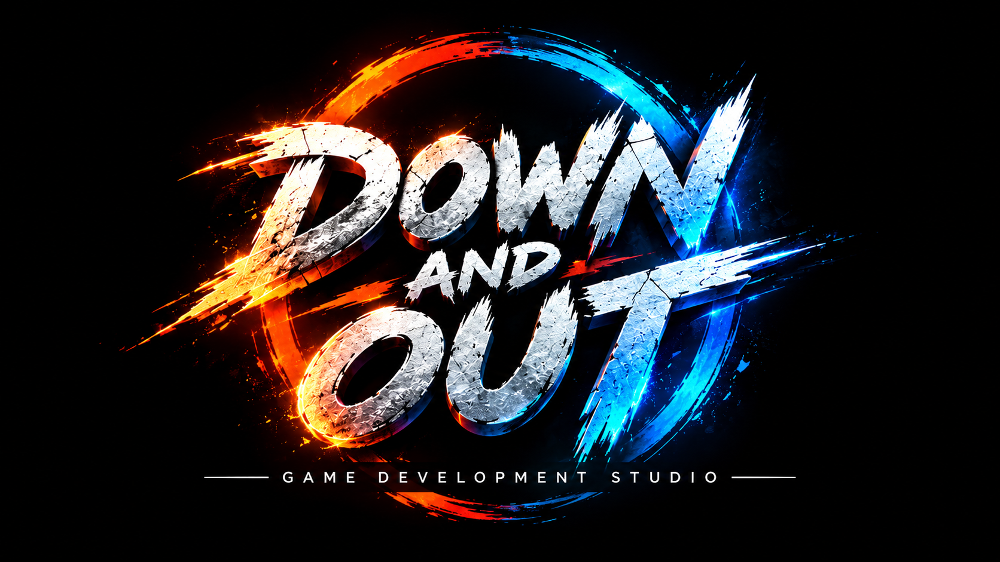

# Down & Out Games

Independent games, colourful worlds and a little clockwork chaos.

[Visit our website](https://downandoutstudios.github.io/) · [Play Fuse Frenzy](https://downandoutstudios.github.io/play/)

## Fuse Frenzy browser playtest

Place bombs, break wooden crates, uncover upgrades and defeat the clockwork enemies. Metal blocks stop your blast. Walk into the glowing teleport gate after clearing an arena.

The browser port runs on each player's device, with no account or download needed. New campaign levels are tested individually before release. Each available level hides three of each of the eight power-up types. The Unreal Engine version remains a separate game build.

**Controls:** WASD or arrows to move, Space to place a bomb, Q/E to rotate, Escape to pause, and F to detonate remote bombs after collecting that upgrade.

Sound starts off; use the Sound button to enable music. The Report a problem button downloads a report that you can send to the studio.

## Studio updates

Newsletter registration is being prepared and is not collecting email addresses yet. The website will also support the studio's future custom domain.

This repository contains the public website and browser game. Private development audits and the original Unreal project are kept separately.
